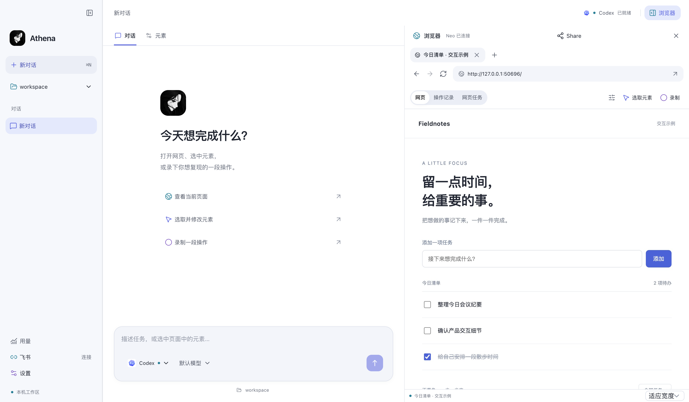

<p align="center">
  
</p>

<h1 align="center">ATHENA</h1>

<p align="center">
  <strong>在一个工作台里，处理项目与网页任务。</strong>
</p>

<p align="center">
  让 Codex 处理项目，在真实网页上预览修改，与他人一起查看结果。
</p>

<p align="center">
  <a href="https://github.com/Dylan-Nihilo/athena/releases/download/v0.7.0/Athena-0.7.0-mac-arm64.dmg"><strong>下载 macOS 版</strong></a>
  &nbsp;·&nbsp;
  <a href="docs/user-guide.md">使用指南</a>
  &nbsp;·&nbsp;
  <a href="CHANGELOG.md">查看更新</a>
</p>

<p align="center">
  <sub>macOS · Apple Silicon · v0.7.0</sub>
</p>

<p align="center">
  
</p>

<p align="center"><sub>项目、对话与网页，在同一个窗口里。</sub></p>

## 从任务，到看得见的结果

### 把项目任务交给 Codex

复用本机 Codex 的已有登录，在选定的项目目录中开展工作。查看计划与执行结果，处理审批或补充信息，也可以随时停止当前任务。模型选择和用量都有独立入口。

### 选中网页元素，直接调整

在真实网页中选中元素，调整文字、颜色、间距与布局，预览效果并随时撤销。需要修改源码时，可以把选中元素和预览改动作为上下文交给 Codex；页面预览与源码保存分开处理。

### 共享当前网页，一起查看

通过邀请让他人加入当前页面，分别管理查看权限、操作权限和当前控制权。共享过程中保留操作记录，方便一起核对变化。[了解页面协作 →](docs/shared-workspace.md)

## 三步开始

1. **打开 Athena。** 下载 DMG，将应用拖入 Applications。
2. **完成首次准备。** 引导会检测 Codex 与已有登录，按需展示安装计划，再由你选择和确认工作目录。网页工具可以稍后准备。
3. **开始第一个任务。** 输入想完成的事，或展开浏览器，打开需要处理的页面。

<details>
<summary>看看与 Athena 的第一次对话</summary>

选择和实际结果会保留在连续对话中。你可以回看，也可以稍后设置；已有用户直接进入工作台，并能从设置重新打开引导。


</details>

**当前版本：[0.7.0](https://github.com/Dylan-Nihilo/athena/releases/tag/v0.7.0)** · [ZIP 归档](https://github.com/Dylan-Nihilo/athena/releases/download/v0.7.0/Athena-0.7.0-mac-arm64.zip) · [SHA-256 校验](https://github.com/Dylan-Nihilo/athena/releases/download/v0.7.0/SHA256SUMS.txt) · [全部版本](https://github.com/Dylan-Nihilo/athena/releases)

> 当前安装包采用 ad-hoc 签名，尚未做 Apple 公证，也没有自动更新。安装包不包含用户登录或 BrowserOS neo；引导会按需准备运行组件。

## 使用之前

- **任务执行由 Codex 提供。** 模型请求使用对应 CLI 账户的配额或计费；其他 CLI 的安装检测不代表已接入执行。
- **网页功能需要 BrowserOS neo。** 使用独立的浏览器数据，不导入日常浏览器配置；普通 Chrome 不能替代它。
- **费用展示为 API 等价估算。** 它不代表订阅实际扣费；未知或不完整的用量会保留其状态。
- **已有数据继续保留。** 沿用原数据目录、钥匙串和工具协议。详见 [数据与凭据](docs/user-guide.md#数据与凭据)。

桌面 Computer Use 仍处调研阶段。当前能力与验证范围见 [用户指南](docs/user-guide.md#能力与验证边界)。

## 文档

| 开始使用                                                    | 进一步了解                                                         |
| ----------------------------------------------------------- | ------------------------------------------------------------------ |
| [用户指南](docs/user-guide.md) · 安装、引导与日常使用       | [设计约定](DESIGN.md) · 视觉语言与组件映射                         |
| [页面协作](docs/shared-workspace.md) · 邀请、权限与控制权   | [工程约定](AGENTS.md) · 开发与验证规则                             |
| [飞书连接](docs/feishu-setup.md) · 配对与连接恢复           | [Computer Use 交接](docs/computer-use-handoff.md) · 实现与研究边界 |
| [模型与用量](docs/agent-experience.md) · 执行证据与统计口径 | [更新日志](CHANGELOG.md) · 版本变化与下载                          |

<details>
<summary><strong>从源码开发</strong></summary>

需要 Node.js **22.12+**、npm，以及有效的 HeroUI Pro 构建授权。

```bash
npm ci
npm run setup:browseros
npm run dev
```

`npm ci` 会执行 `heroui:setup`，优先恢复本机授权缓存。新环境需私下配置 `HEROUI_KEY`；不要提交密钥或完整 Pro 包。`setup:browseros` 下载并校验固定官方版本，不启动浏览器或覆盖系统安装。

```bash
npm run typecheck
npm test
npm run build
npm run package
```

运行任务还需已登录的 Codex。完整环境说明和测试范围见 [开发环境与验证](docs/user-guide.md#开发环境与验证)。

</details>

## 许可

本仓库公开可见，项目代码保持 **UNLICENSED**，尚未授予开源许可证。HeroUI Pro 是商业授权组件，其完整包、源码和密钥不随本仓库分发。第三方许可见 [THIRD_PARTY_NOTICES](THIRD_PARTY_NOTICES.md)。
